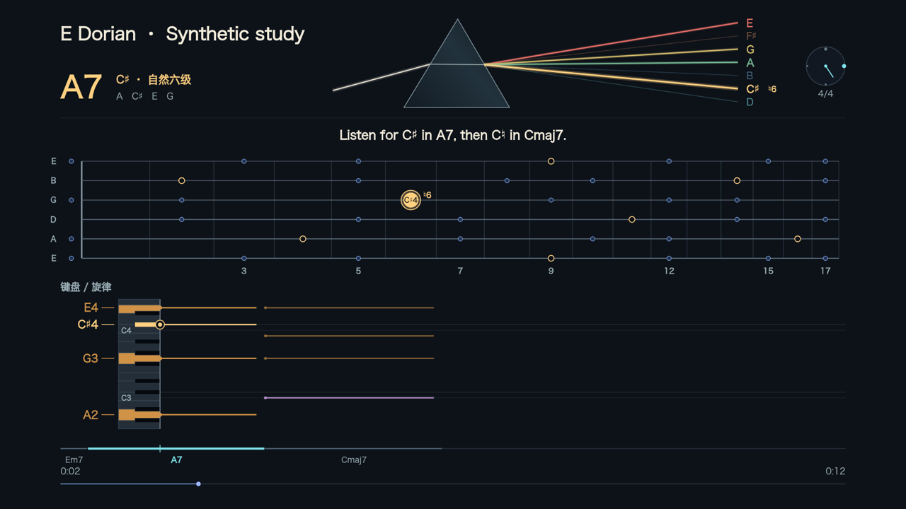
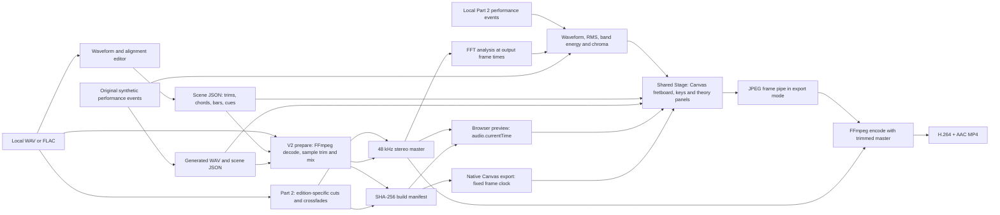

# Dorian Mode Visualizer

I started this project to hear what happens when a minor-key vamp raises its sixth. The guitar fretboard shows where that note sits, the keyboard shows which voices stay put, and the audio gives you a way to hear the difference. The case studies come from Pink Floyd’s *The Dark Side of the Moon*. The quick start uses original synthetic studies so you can run it from a fresh clone.



## Run the demo

Install **Node.js 22 or later** with npm, **FFmpeg** with `libx264` and AAC encoding, and **FFprobe**. Use a recent Chrome or Chromium for preview. The Canvas renderer uses fonts installed on your machine. For Chinese captions, install Noto Sans CJK SC or point `DORIAN_FONT` at a local font file. On macOS the exporter defaults to the system Hiragino Sans GB font.

```sh
git clone https://github.com/GSflaming/dorian-mode-visualizer.git
cd dorian-mode-visualizer
npm ci
npm run demo
npm run preview
```

Open [the local preview](http://127.0.0.1:4181/?mode=part2-demo) and press Play. Use the scene selector to jump among E, D, and G Dorian. The fretboard and keyboard share the same timeline as the recording.

Render the entire 12.8-second study or export a single frame at 2.25 seconds.

```sh
npm run render -- --study-demo
npm run render -- --study-demo --snapshot-ms 2250
```

Look in `ep01/v1/output/v2/part2-demo/` for `Dorian-V2.mp4`, the 48 kHz PCM master, per-frame features, and the build manifest. The MP4 is 1920 × 1080 at 30 fps with H.264 video and stereo AAC audio.

## What to listen for

Dorian contains `1 2 ♭3 4 5 6 ♭7`. E Dorian spells that as E–F♯–G–A–B–C♯–D. The minor third gives E its minor quality. The natural sixth, C♯, gives A7 its major third. In E natural minor the corresponding pitch is C♮, which gives Am7 its minor third. The V2 A/B scene holds the surrounding notes steady while moving C♮ to C♯.

The case studies follow local tonal centers in three tracks on the 1973 album. The synthetic examples isolate the same harmonic ideas with their own voicings and timing.

| Track | Passage | Listen for |
| --- | --- | --- |
| “Breathe (In the Air)” | E Dorian vamp, Em(add9)/Em7 ↔ A7 | C♯ on A7, then C♮ when Cmaj7 enters. |
| “Any Colour You Like” | D Dorian vamp, Dm7 ↔ G7 | C moves to B♮ across the change. The vamp continues through the synth-to-guitar handoff. |
| “The Great Gig in the Sky” | G Dorian in the Gm7 ↔ C9 sections | F moves down to E♮ while G, B♭ and D can stay in place. |

[Official album credits](https://www.pinkfloyd.com/albums/the-dark-side-of-the-moon/) · [Milton Mermikides’s album lecture](https://www.gresham.ac.uk/watch-now/illuminating-dark-side-moon) · [Nick Braae’s analysis of structure and closure](https://www.mtosmt.org/issues/mto.26.32.1/mto.26.32.1.braae.html)

## Import your own audio

1. Put a WAV or FLAC you have permission to use in `ep01/assets/audio/tracks/`.
2. For an independent project, copy `examples/local-audio.json` to `ep01/v1/config/v2.json` and set `audio.file` to your filename. Set the excerpt length with `endMs` and `durationMs`. Git can restore the album template when you want it back.
3. Run `npm run align` and open the printed local address. Select your recording, trim the excerpt on the waveform, mark bars, beats, chords and captions, and save the program configuration.
4. Run `npm run audio:prepare` and open [the local V2 preview](http://127.0.0.1:4182/?mode=v2) while the server is running. Re-run preparation after each edit to the recording or configuration.
5. Run `npm run render` to render the whole program to `ep01/v1/output/v2/Dorian-V2.mp4`. Use `-- --scene my-excerpt` for a single scene.

Scene and cue times are integer milliseconds on the program timeline. `audio.sourceInMs` is the offset into the original file. See [workflow details](docs/workflows.md) for the alignment controls, native render options, and the edition-specific eight-scene Part 2 build.

## From audio to Canvas



The default Node analysis measures waveform peaks, frame RMS, energy in three frequency bands and twelve pitch classes. Chord names and modal changes come from scene annotations. Chromagram peaks describe the mix, including overtones. Fingering and moving keyboard notes in case-study views come from timed performance events.

| Path | Contents |
| --- | --- |
| `ep01/v1/v2-stage.mjs`, `ep01/v1/part2/draw.mjs` | Shared Canvas stage, prism, guitar fretboard and scrolling keyboard |
| `ep01/v1/v2/` | Browser playback, alignment, worker and DSP |
| `ep01/v1/part2/lesson.mjs`, `recording-bars.json` | Song sections, harmonic annotations and recording clock anchors |
| `ep01/v1/config/` | User-editable timeline, schema and V1 score |
| `ep01/v1/scripts/` | Audio preparation, native Canvas rendering and acceptance scripts |
| `examples/` | Synthetic study recipe and a WAV/FLAC project template |
| `ep01/v1/vendor/`, `ep01/vendor/` | Local copies of theory, timing and instrument drawing helpers |
| `ep01/tests/`, `ep01/v1/tests/`, `docs/` | Tests, workflow notes and verification records |

## Versions

- **V0.1** is the original 56-second C♮/C♯ prototype. It uses the browser Canvas and a Chrome/FFmpeg export path.
- **V1** is a 195-second arranged lesson driven by a generated score and MIDI. Its source and tests are kept for comparison. Its sample-based mix requires a compatible local DLS instrument bank.
- **V2 + Part 2** is the current pipeline. V2 added recording alignment, audio analysis and a shared browser/offline stage. Part 2 added eight album excerpts and the dark prism, fretboard and keyboard treatment used by the public synthetic demo.

## Test and verify

```sh
npm test
npm run verify
npm run verify:browser
```

`npm test` runs timeline, score, feature, render and study checks. `npm run verify` also encodes and decodes the V2 fixture, checks stream durations and regenerates the synthetic studies. `npm run verify:browser` uses Chrome or Chromium to verify playback, guitar and keyboard changes, and scene seeking. Set `CHROME_PATH` if Chromium is installed under a different name or location. See [verification results](docs/verification.md) for the clean-environment run.

## License and music rights

Project code and the original synthetic examples are released under the [MIT License](LICENSE). Vendored code keeps its own notices. The license applies to the project’s contributions. Pink Floyd’s music, recordings, transcriptions, and album artwork remain with their respective rights holders. The repository contains original demo code, a synthetic-render screenshot, and editorial analysis. Recordings, scores, and performance data supplied for local study stay on your machine. See the [third-party notices](THIRD_PARTY_NOTICES.md).
